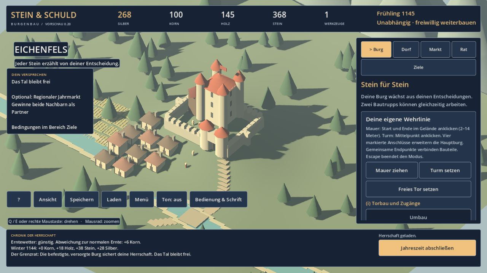

# Stein & Schuld – Das freie Tal

**Eine Burg. Ein Tal. Zwölf Jahreszeiten für seine Unabhängigkeit.**

Eine spielbare Vorschau einer Burgen- und Wirtschaftssimulation mit Godot.
Du übernimmst Eichenfels, baust seine Burg aus, versorgst die Menschen und
entscheidest, welche Verpflichtungen du gegenüber deinen Nachbarn eingehst.

## Windows-Demo herunterladen

**[Demo 0.20 für Windows x64 herunterladen – rund 40 MB](https://github.com/Moavalon/Stein-und-Schuld-demo/releases/download/v0.20-demo/Stein-und-Schuld-Demo-0.20-Windows-x64.zip)**

[Startanleitung](ANLEITUNG.txt) · [Release und Prüfsumme](https://github.com/Moavalon/Stein-und-Schuld-demo/releases/tag/v0.20-demo) · [Herkunft und Lizenzen](HINWEISE.txt)

Das ZIP vollständig entpacken und **Stein-und-Schuld-0.20.exe** starten.
Keine Godot- oder Node.js-Installation, kein Konto und keine Internetverbindung
zum Spielen nötig. Sprache: **Deutsch**. Die Demo hat kein Zeitlimit.

## Was ist spielbar?

Die vollständige erste Geschichte **Das freie Tal** mit Einführung, freiwilliger
Einstiegshilfe und drei Startschwierigkeiten. Nach zwölf abgeschlossenen
Jahreszeiten entscheidet der Grenzrat über die Unabhängigkeit deines Tals.

Du brauchst ein fertiges Torhaus, ausreichende Kornvorräte und Zustimmung.
Zusätzlich sicherst du das Tal durch einen Bergfried, eine eigene Wehrlinie
oder tragfähige diplomatische Beziehungen. Bauen, Arbeit einteilen, Handel,
Verträge und Versorgung greifen ineinander. Dein Fortschritt steht unter
**Ziele**; Zeit vergeht erst, wenn du eine Jahreszeit abschließt.

Ein erklärtes Ergebnis schließt die Geschichte ab. Danach kannst du freiwillig
weiterbauen. **Die Belagerung**, **Die Handelsburg** und **Zuflucht Eichenfels**
sind geplante weitere Geschichten und in dieser Demo noch gesperrt.

## Voraussetzungen und Prüfstand

Zielplattform: Windows 10/11 x64, Maus und Tastatur, geeigneter Grafiktreiber.
Details einschließlich Grafik- und CPU-Voraussetzungen stehen in der
[Anleitung](ANLEITUNG.txt). Empfohlenes Fenster: mindestens 1280 × 720.

Die entpackte EXE wurde mit Einstiegs-, Auswahl-, Umbau- und gerenderten
Bau-/Kameraprüfungen getestet. Mit ihren eingebetteten Spielressourcen wurden
alle drei Schwierigkeiten regulär über zwölf Jahreszeiten gewonnen und
Speicherstände exakt wieder geladen. Diese technischen Prüfungen ersetzen
keine vollständige Abnahme auf frischen Windows-Rechnern oder verschiedenen
Grafikkarten. Die Demo wird noch bei Texten, Balance und Grafik verbessert.
Die Schwierigkeiten unterscheiden sich derzeit durch ihre Startvorräte.

Die EXE ist **nicht mit einem Herausgeberzertifikat signiert**. Windows oder
Browser können warnen oder die Ausführung einschränken. Die beim Release
bereitgestellte SHA-256-Prüfsumme prüft die Dateiübereinstimmung und ersetzt
keine Herausgebersignatur. Firmen- und Geräterichtlinien beachten.

## Spielstände und Rückmeldungen

Drei eigene Speicherplätze und automatische Sicherungen sind vorhanden.
Spielstände werden lokal außerhalb des Programmordners abgelegt; Speicherort
und Hinweise vor einem Update stehen in der [Anleitung](ANLEITUNG.txt).
Das Spiel enthält keinen automatischen Upload von Spielständen oder Fehlerberichten.

[Fehler oder Rückmeldung melden](https://github.com/Moavalon/Stein-und-Schuld-demo/issues).
Bitte Version, Windows-Version und die Schritte bis zum Problem nennen.
**GitHub-Issues sind öffentlich:** keine persönlichen Angaben, ungeschwärzten
Screenshots oder vollständigen privaten Dateien einstellen.

## Über das Projekt

Projekt von [Roman Gutmann](https://roman-gutmann.at/).
Idee, Anforderungen, gestalterische Entscheidungen und Projektsteuerung:
Roman Gutmann. Programmierung und technische Umsetzung mit OpenAI Codex.
Technik: **Godot und GDScript**.

Das frühere JavaScript-Burgenbauprojekt ist ein eigenständiger Vorläufer.
Stein & Schuld ist eine Neuentwicklung mit anderer technischer Grundlage.

Dieses Repository enthält öffentliche Beschreibung, Anleitung, Spielbild und
fertige Downloads. Das separate Quellprojekt und interne Entwicklungsunterlagen
werden hier nicht veröffentlicht. Die EXE enthält die benötigten Spielressourcen;
es wird kein technischer Ausleseschutz behauptet. Hinweise zu Spielinhalten,
Godot und Drittkomponenten stehen in [HINWEISE.txt](HINWEISE.txt).
